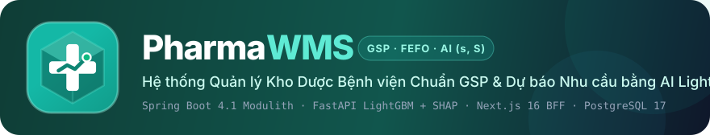
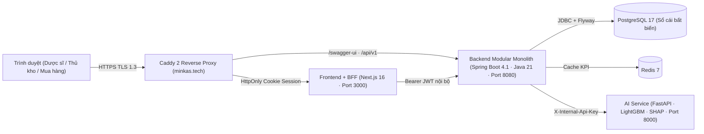

<p align="center">
  
</p>

# PharmaWMS — Hệ thống Quản lý Kho Dược GSP & Dự báo Nhu cầu AI

[](https://github.com/minKasent/pharmawms/actions/workflows/ci-cd.yml)
[](https://minkas.tech)
[](https://minkas.tech/swagger-ui/index.html)

Hệ thống quản lý kho thuốc bệnh viện đạt chuẩn **Thực hành tốt bảo quản thuốc (GSP — Thông tư 36/2018/TT-BYT & Thông tư 11/2025/TT-BYT)**: kiểm soát nhiệt độ khu vực bảo quản, phân bổ xuất kho **FEFO** chống tranh chấp đồng thời, truy vết hộ chiếu lô & thu hồi khẩn cấp, kết hợp **AI dự báo nhu cầu (LightGBM Tweedie + SHAP)** và **tối ưu hóa đặt hàng định kỳ $(R, s, S)$ có xét hạn dùng (Expiry-Aware Inventory Position)**.

## Kiến trúc Hệ thống



| Thành phần | Công nghệ | Cổng |
|---|---|---|
| **Backend** | Spring Boot 4.1 / Java 21 / Spring Modulith / PostgreSQL 17 / Redis 7 | `8080` |
| **AI Service** | Python 3.12 / FastAPI / LightGBM (`tweedie`) / TreeSHAP | `8000` |
| **Frontend** | Next.js 16 (App Router, Cache Components, BFF Cookie Session) | `3000` |

Backend được thiết kế theo kiến trúc **Modular Monolith** (`IAM`, `Catalog`, `Inventory`, `Purchasing`, `Forecasting`) kiểm chứng biên giới mô-đun tự động bằng `ApplicationModules.verify()`. Frontend giao tiếp qua tầng BFF `/api/backend/...`, lưu JWT trong `HttpOnly` cookie và tự động xoay vòng Refresh Token.

## Kết quả Thực nghiệm Đối chứng 4 Chính sách Tồn kho (365 ngày · 80 SKU)

| Chính sách | Tỷ lệ đáp ứng (Fill Rate) | Số ngày đứt hàng | Giá trị hủy do hết hạn | Tổng chi phí vận hành |
|---|---:|---:|---:|---:|
| **P0 — Min/Max tĩnh truyền thống** | `94,35%` | `462` | `434.250.360 ₫` | `781.908.352 ₫` |
| **P1 — Trung bình trượt + $(R, s, S)$ cơ bản** | `98,04%` | `173` | `269.926.120 ₫` | `481.872.503 ₫` |
| **P2 — AI LightGBM + $(R, s, S)$ chuẩn** | `98,63%` | `109` | `113.511.900 ₫` | `471.734.424 ₫` |
| **P3 — AI LightGBM + $(R, s, S)$ có xét hạn dùng GSP (Đề xuất)** | **`98,87%`** | **`88`** | **`48.100.890 ₫` (`-88,9%`)** | **`397.022.393 ₫` (`-49,2%`)** |

## Chạy nhanh bằng Docker Compose

```bash
cd infra
cp .env.example .env   # chỉnh mật khẩu nếu cần
docker compose up --build
```

Sau khi healthy:

- Web: http://localhost:3000
- API: http://localhost:8080/actuator/health
- AI: http://localhost:8000/health
- OpenAPI: http://localhost:8080/swagger-ui.html

### Tài khoản demo

Mật khẩu mặc định: `Demo@123` (đổi bằng `DEMO_PASSWORD`).

| Username | Vai trò |
|---|---|
| `admin` | Quản trị hệ thống |
| `duocsi` | Dược sĩ phụ trách (duyệt đơn / duyệt kiểm kê) |
| `thukho` | Thủ kho (nhập / xuất / kiểm kê) |
| `muahang` | Nhân viên mua hàng (đơn mua / đề xuất AI) |

Người lập không được tự duyệt đơn mua hoặc phiếu kiểm kê (tách nhiệm vụ).

## Chạy local (dev)

Cần: JDK 21, Maven 3.9+, Node 22+, Python 3.12+, Docker (Postgres + Redis).

```bash
# 1. Hạ tầng
cd infra && docker compose up -d postgres redis

# 2. Backend
cd ../backend
mvn spring-boot:run

# 3. AI (cần AI_API_KEY trùng backend)
cd ../ai-service
python -m venv .venv
# Windows: .\.venv\Scripts\Activate.ps1
source .venv/bin/activate
pip install -r requirements.txt
AI_API_KEY=dev-internal-key uvicorn app.main:app --port 8000

# 4. Frontend
cd ../frontend
cp .env.example .env.local
npm install
npm run dev
```

Biến môi trường quan trọng:

| Biến | Mặc định | Ý nghĩa |
|---|---|---|
| `DB_URL` / `DB_PASSWORD` | localhost Postgres | Kết nối DB |
| `REDIS_HOST` | localhost | Cache |
| `AI_BASE_URL` / `AI_API_KEY` | `http://localhost:8000` / `dev-internal-key` | Gọi AI |
| `JWT_PRIVATE_KEY_PEM` / `JWT_PUBLIC_KEY_PEM` | (trống) | RSA cho JWT; trống = khóa tạm, mất khi restart |
| `BACKEND_URL` (frontend) | `http://localhost:8080` | BFF gọi backend |
| `DEMO_ENABLED` / `DEMO_PASSWORD` | true / `Demo@123` | Seed tài khoản demo |

## Dữ liệu giả lập + huấn luyện mô hình

```bash
# Reset DB rồi nạp ~24 tháng giao dịch (hỗ trợ --today YYYY-MM-DD để tái lập dữ liệu cố định)
cd scripts
python datagen/seed.py --reset --today 2026-10-12
python run_forecast.py

# Mô phỏng đối chứng 4 chính sách tồn kho (P0 Min/Max vs P1 MA vs P2 LightGBM vs P3 LightGBM + Expiry-Aware)
python simulate_policies.py
```

Sau khi train, trang **Dự báo nhu cầu** hiện backtest WAPE/MASE so với baseline; **Đề xuất nhập** hiện các dòng (R, s, S).

## Kiểm thử toàn hệ thống

```bash
# 1. Backend (Unit + Modulith + Testcontainers PostgreSQL & Redis)
cd backend && ./mvnw test

# 2. AI Service (Feature leakage guard, scale-free MASE, LightGBM + SHAP, seed integrity)
cd ai-service && pytest

# 3. Frontend (Unit tests + TypeScript strict + ESLint)
cd frontend && npm test && npm run typecheck && npm run lint

# 4. E2E Smoke Test (yêu cầu hệ thống đang chạy)
python scripts/smoke_test.py
```

## Triển khai Production (Azure + Caddy HTTPS + CI/CD)

Hệ thống đang vận hành thực tế trên **Microsoft Azure** với chứng chỉ SSL/TLS Let's Encrypt tự động qua Caddy:

- **Web App (HTTPS):** https://minkas.tech (và https://www.minkas.tech)
- **Swagger UI (HTTPS):** https://minkas.tech/swagger-ui/index.html
- **OpenAPI 3.1 Spec:** https://minkas.tech/v3/api-docs

### 1. Triển khai 1 lệnh lên máy chủ Ubuntu (Azure VM)

```bash
chmod +x infra/deploy-azure.sh infra/backup-db.sh
sudo DOMAIN=minkas.tech ./infra/deploy-azure.sh
sudo ./infra/backup-db.sh --install-cron
```

### 2. Đường ống CI/CD Tự động (`.github/workflows/ci-cd.yml`)

Mỗi lần tạo Pull Request hoặc đẩy code lên nhánh `main`, GitHub Actions tự động thực thi 5 cổng kiểm soát chất lượng:

1. **`backend-ci`:** Chạy 89 bài kiểm thử JUnit 5 + Spring Modulith Architecture Verification + Testcontainers (PostgreSQL 16 & Redis 7) + xuất báo cáo độ phủ JaCoCo.
2. **`ai-service-ci`:** Chạy 30 bài kiểm thử `pytest` (chống rò rỉ tương lai, MASE chuẩn hóa theo SKU, LightGBM Tweedie + SHAP, và kiểm chứng toàn vẹn dữ liệu giả lập 730 ngày).
3. **`frontend-ci`:** Kiểm tra ESLint, TypeScript `strict`, 11 bài unit test và đóng gói bản build `standalone` cho toàn bộ 35 route Next.js 16.
4. **`e2e-smoke-gate`:** Dựng cụm Docker Compose và chạy `scripts/smoke_test.py` kiểm chứng 33 kịch bản nghiệp vụ đầu-cuối.
5. **`deploy-production`:** Tự động tạo bản chụp PostgreSQL (`infra/backup-db.sh`), đồng bộ mã nguồn lên Azure VM, cập nhật container không gián đoạn và kiểm tra sức khỏe HTTPS sau triển khai.

## Cấu trúc thư mục

```
pharmawms/
  .github/          GitHub Actions CI/CD (ci-cd.yml) & Dependabot
  backend/          Spring Boot modular monolith
  ai-service/       FastAPI + LightGBM
  frontend/         Next.js App Router
  infra/            docker-compose (dev & prod) + Caddyfile + deploy-azure.sh + backup-db.sh
  scripts/          seed dữ liệu + chạy forecast + mô phỏng 4 chính sách + E2E smoke test
```

## Ghi chú bảo mật demo

- Không commit file `.env` / khóa JWT / mật khẩu thật.
- Cookie auth chỉ nên `Secure` trên HTTPS (`COOKIE_SECURE=true` trong production).
- `AI_API_KEY` là shared secret nội bộ giữa backend và AI service (header `X-Internal-Api-Key`).
